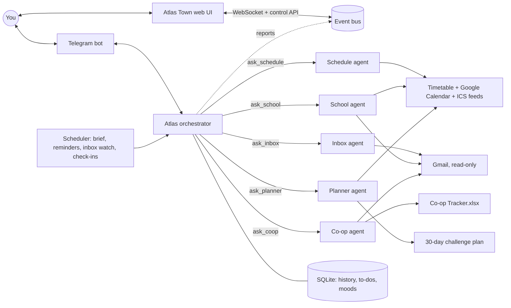

# Atlas: a multi-agent personal assistant

Atlas is a personal assistant you text from your phone, with **Atlas Town**: a live pixel town where
you can watch every agent work and take control of it. An orchestrator agent talks to you and
hands work to five specialist agents, each with its own tools. It also reaches out on its own:
a morning brief, reminders before classes and deadlines, alerts for important email, an evening
check-in and a Sunday weekly review.



## Atlas Town

Every agent lives in a building and walks around town. When Atlas hands work to a specialist, a
letter flies from HQ to that building. Speech bubbles show what each agent is thinking or which
tool it's using, and windows light up when a building is busy (and at night).

- **Watch:** a live activity feed, plus each agent's status, model calls, tokens and estimated cost
- **Control:** pause or resume any agent (or everyone), and set how hard each one thinks (effort)
- **Routines:** turn scheduled jobs on or off, or run one right now
- **Chat:** talk to Atlas by text or voice (browser speech recognition), with optional spoken replies

| Resident | Building | Job |
|---|---|---|
| Atlas | HQ | Orchestrator |
| Chrono | Clock Tower | Schedule |
| Posty and Dash | Post Office | Inbox, and new-mail watch |
| Sage | Library | School deadlines |
| Scout | Career Center | Co-op hunt |
| Juniper | Greenhouse | Day planning |

**Try it without any accounts:**
```bash
cd ui && npm install && npm run build && cd ..
python -m atlas --demo        # open http://127.0.0.1:8787, token: demo
```
Demo mode runs the real agents, tools and UI on a scripted stand-in for Claude, with sample email.

**Architecture:** every agent reports to an in-process event bus (`atlas/events.py`). A FastAPI server
(`atlas/web.py`) streams those events over a WebSocket and exposes the controls. The React + Canvas
UI (`ui/`) draws the town at 384×240 and scales it up pixel-perfect.

| Agent | Answers | Tools |
|---|---|---|
| **Atlas** (orchestrator) | Everything you send; decides who to ask | `ask_*` for each specialist, to-dos, mood log |
| Schedule | "What do I have today?", free time, conflicts | merged calendar |
| Inbox | Email summaries, what needs a reply | Gmail search/read |
| School | Assignments, quizzes, midterms, time left | calendar, deadlines, to-dos, Gmail |
| Co-op | Application progress, what to apply to next, follow-ups | tracker spreadsheet, Gmail |
| Planner | A day plan adjusted to your energy (1–5) | calendar, deadlines, to-dos, moods, challenge |

## What happens automatically (Toronto time)

| When | What |
|---|---|
| Every 5 min | Reminders 20 min before class, 30 min before work and events. Deadlines at 3 days, 24 h and 3 h |
| Every 30 min | New unread email checked; you're only pinged for things that need you |
| 7:15 AM Sun–Thu, 9:00 AM Fri–Sat | Morning brief |
| 9:00 PM daily | Evening check-in: tomorrow's preview and how you're feeling |
| Sunday 11:30 AM | Weekly review |

No messages between 11 PM and 7 AM. Anything that came up overnight is sent after 7.

Commands: `/today /tomorrow /week /inbox /deadlines /coop /plan /tasks`, or just type normally:
"I'm wiped today, energy 2", "remind me to email my TA Friday at noon", "anything from recruiters?"

## Setup

### 1. Keys
- **Telegram:** message [@BotFather](https://t.me/BotFather), send `/newbot`, and copy the token.
- **Claude:** create an API key at console.anthropic.com. Set a monthly spend limit there.
- `cp .env.example .env` and fill both in.

### 2. Google (Gmail + Calendar, read-only)
1. At console.cloud.google.com, create a project and enable the **Gmail API** and **Google Calendar API**.
2. Under **OAuth consent screen**, choose External and add yourself as a test user.
3. Then **publish the app** (set it to "In production"). While it's in Testing mode, Google expires the login after 7 days and Atlas loses access. Since the app is only for you, the "unverified app" warning is fine to click through.
4. Under **Credentials**, create an OAuth client ID of type **Desktop app**, download the JSON and save it as `secrets/client_secret.json`.
5. On your Mac, run `python -m atlas.setup_google`. Sign in and `secrets/token.json` appears.

### 3. School and Apple calendars (ICS feeds in `ICS_FEEDS`)
- **Avenue to Learn:** Calendar → Subscribe → copy the feed link.
- **School Outlook calendar:** Outlook web → Settings → Calendar → Shared calendars → Publish → ICS link.
- **iCloud calendar:** Calendar app → right-click the calendar → Share → Public Calendar → copy the link.

### 4. Your profile and timetable
`cp data/profile.example.md data/profile.md` and `cp data/timetable.example.json data/timetable.json`,
then fill in who you are and your classes. Both files are git-ignored, so your personal details stay
off GitHub. Atlas falls back to the examples when they're missing.

### 5. Co-op tracker
Copy `Co-op Tracker.xlsx` into `data/`. After deploying, keep the server's copy up to date with
`deploy/sync_tracker.sh`, run from your Mac (hourly with cron is enough).

### 6. Run it
```bash
uv venv && uv pip install -r requirements-dev.txt
python -m pytest            # 21 tests, no network needed
python -m atlas             # then send /start to your bot and paste the id into TELEGRAM_OWNER_ID
```

### 7. Open Atlas Town
Build the UI once (`cd ui && npm install && npm run build`). `python -m atlas` then serves it at
http://127.0.0.1:8787 and prints the access token in its log (or set `ATLAS_UI_TOKEN` in `.env`).
For UI development, run `npm run dev` in `ui/`; it proxies to the running Atlas.

### 8. Deploy (VPS, ~$5/month)
Any small Ubuntu VPS works (Hetzner, DigitalOcean, Lightsail). Clone the repo and create the venv,
then copy `.env`, `secrets/` and `data/Co-op Tracker.xlsx` over with rsync. Finally:
```bash
(cd ui && npm ci && npm run build)
pm2 start deploy/ecosystem.config.js && pm2 save && pm2 startup
```
**Reaching Atlas Town from your phone:** keep `ATLAS_UI_HOST=127.0.0.1` so it's never exposed to the
open internet. Install [Tailscale](https://tailscale.com) on the server and your phone, then run
`tailscale serve --bg 8787` on the server. The town is at `https://<server>.<tailnet>.ts.net` for
your devices only, and you can add it to your home screen.

## Known limits
- **University email:** Microsoft 365 at universities usually blocks third-party apps. Atlas reads school mail if you set Outlook to **forward to Gmail**; if your school blocks forwarding, that mail isn't readable yet.
- **Apple Reminders** can't be read from a Linux server. Tell Atlas "remind me…" and it keeps its own to-do list with due-time pings.
- Atlas can **read** email and calendars but **can't send or change** anything. Replies are drafted as text for you to send.
- Email and calendar text is untrusted. The prompts tell every agent to report it, never obey it, and the tools are read-only, so a malicious email can't make Atlas act.

## Cost
By default every agent runs on **Claude Haiku 4.5**, the cheapest model ($1 / $5 per million input /
output tokens, and no billed "thinking"). Estimated monthly API spend:

| Use | Questions a day | API cost / month |
|---|---|---|
| Light | 2 | ~$5 |
| Moderate | 5 | ~$8 |
| Heavy | 15 | ~$15 |

That covers the morning brief (~$0.06), evening check-in (~$0.03), hourly inbox screening and the
weekly review. Reminders don't use the API at all. Add ~$5/month for the server.

For smarter answers, upgrade the agent that matters most first: `ATLAS_MODEL=claude-sonnet-5` puts
Atlas itself on Sonnet 5 (roughly doubles the bill); `claude-opus-5` is the most capable and ~5x the cost.
Atlas Town shows each agent's live token count and estimated cost, and a monthly spend limit in the
Claude Console caps the bill.

## Roadmap
- [ ] "Hey Atlas" wake word in Atlas Town, like Jarvis
- [ ] Voice notes: transcribe Telegram voice messages (faster-whisper) and optionally reply with audio
- [ ] Approve-before-acting: let agents draft emails or calendar changes that wait for your OK in the town
- [ ] Apple Reminders sync through an iOS Shortcut webhook
- [ ] Update co-op statuses from chat (writes to the tracker)
- [ ] Morning phone call (Twilio Voice)
- [ ] Eval set of 30 real questions with expected answers, to catch regressions when prompts change
